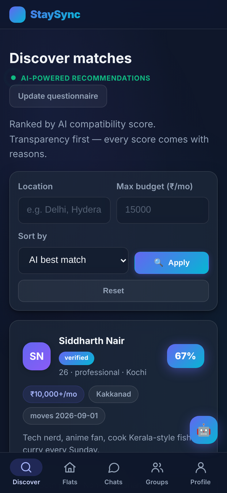
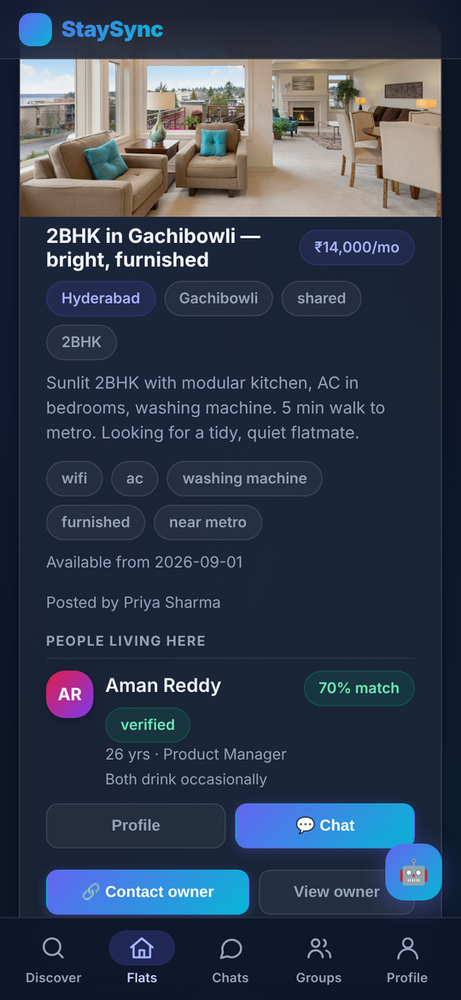
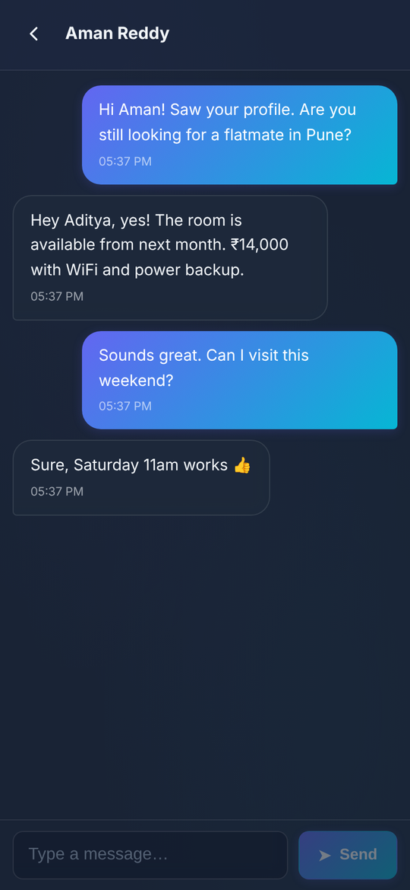
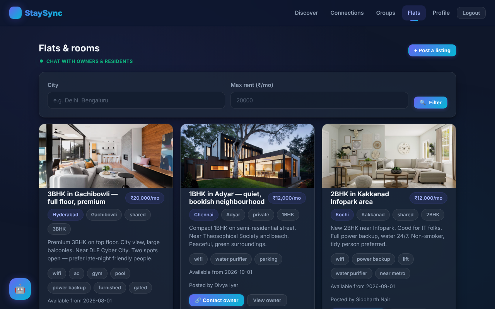

<div align="center">

# 🏠 StaySync

**Find a room, see the real price and amenities, and talk to the people who already live there, before you move in.**

Roommate compatibility and flat-finding for students and young professionals.
One codebase for the **website**, an installable **PWA**, and **Android / iOS apps**.


</div>

---

## Screenshots

<table>
  <tr>
    <td align="center"><br><sub><b>Discover</b>: ranked matches</sub></td>
    <td align="center"><br><sub><b>Flats</b>: price, amenities, residents</sub></td>
    <td align="center"><br><sub><b>Chat</b>: full-screen, real-time</sub></td>
  </tr>
</table>

<p align="center"></p>

## Why StaySync

Finding a room usually means guessing: the listing shows a price and a few photos, and you only meet your
flatmates after you've signed. StaySync fixes that:

- **See everything up front**: rent, deposit, amenities, photos and availability.
- **Meet the people first**: every listing shows who already lives there, with a compatibility score for *you*.
- **Chat before you commit**: message the owner **and** the current residents.
- **Matches with reasons**: scores are transparent ("Both sleep around 10 PM"), never a mystery percentage.

## Features

| Area | What you get |
|------|--------------|
| **Accounts** | Email/phone registration, password and OTP login, password reset, in-app account deletion |
| **Profiles** | Age, occupation, city/area, budget, move-in date, bio, photos, verified badge |
| **Matching** | 12-question lifestyle questionnaire, weighted compatibility score with plain-language reasons, ML-assisted ranking |
| **Listings** | Search by city, area and rent; rooms or whole flats; amenities, photos; admin approval before going live |
| **Residents** | Posters add the flatmates already living there (they confirm). Seekers see each resident with a match score and can chat |
| **Chat** | One-to-one real-time messaging over WebSockets, online presence, unread counts, toasts |
| **Connections & groups** | Request → accept/decline flow; roommate groups to house-hunt together |
| **Safety** | Report and block users, rule-based moderation agent that scores report severity |
| **Admin** | Users, reports, listings and analytics dashboard |
| **Mobile** | App-style UI (bottom tabs, full-screen chat, safe areas), PWA install, Android & iOS apps |

## How matching works

Weighted, transparent scoring across the questionnaire:

| Category | Weight |
|----------|-------:|
| Lifestyle | 30% |
| Sleep & noise | 20% |
| Budget & location | 20% |
| Cleanliness | 15% |
| Routine | 10% |
| Social | 5% |

A `RandomForestClassifier` (scikit-learn, trained by `backend/scripts/train_model.py` and auto-trained on first
boot) predicts pairwise match probability and is blended into the discovery ranking. It can be retrained on
real interaction data via `POST /api/ml/retrain`.

Three small rule-based **agents** (onboarding guidance, match-reason summaries, report moderation) are designed
to be swapped for an LLM later.

## Architecture

```
 Website / PWA / Android / iOS            ← one React codebase (Capacitor wraps it for the stores)
        │  REST + WebSocket
        ▼
 FastAPI  (Python 3.12)
   ├─ JWT + bcrypt auth, OTP login
   ├─ SQLAlchemy  →  SQLite (dev)  /  PostgreSQL on Supabase (prod)
   ├─ Compatibility scoring + scikit-learn model
   ├─ Rule-based agents (onboarding, match reasons, moderation)
   └─ WebSocket chat manager
```

| Layer | Tech |
|-------|------|
| Frontend | React 18, Vite 6, React Router, `vite-plugin-pwa` |
| Mobile | Capacitor 7 (Android + iOS), see [docs/MOBILE.md](docs/MOBILE.md) |
| Backend | FastAPI, SQLAlchemy, Pydantic, scikit-learn |
| Data | SQLite (development), PostgreSQL via Supabase (production), Supabase Storage for photos |
| Email | Brevo HTTPS API (preferred), SMTP, or console output in development |
| Hosting | Vercel (frontend), Railway (backend), Supabase (database + storage) |

## Getting started

**Requirements:** Python 3.12, Node 20+.

### 1. Backend

```bash
cd backend
python3 -m venv .venv
source .venv/bin/activate            # Windows: .venv\Scripts\activate
pip install -r requirements.txt

cp .env.example .env                 # keep ENV=development locally (ENV defaults to production when unset)
python scripts/seed.py               # optional: demo users, listings, admin
python -m uvicorn app.main:app --reload --port 8000
```

Interactive API docs: <http://localhost:8000/docs>

### 2. Frontend

```bash
cd frontend
npm install
npm run dev
```

Open <http://localhost:5173>. The dev server proxies `/api` (including WebSockets) to the backend.
Use your browser's device toolbar to see the phone layout.

> Demo accounts created by the seed script are for **local development only**. Never seed demo data into a production database.

## Configuration

All backend settings are environment variables (see `backend/.env.example`).

| Variable | Purpose | Default |
|----------|---------|---------|
| `ENV` | `development` or `production`. Production is the default when unset | `production` |
| `DATABASE_URL` | SQLAlchemy URL (`postgresql://…` in production) | local SQLite file |
| `JWT_SECRET` | Signs access tokens. **Must be a long random string in production**; a weak one is replaced by a random key at boot (sessions reset on restart) | placeholder |
| `ACCESS_TOKEN_EXPIRE_MINUTES` | Token lifetime | 10080 (7 days) |
| `CORS_ORIGINS` | Comma-separated allowed web origins (native app origins are always allowed) | localhost + Vercel |
| `CORS_ORIGIN_REGEX` | Extra origins allowed by pattern (Vercel previews) | `^https://stay-?sync[a-z0-9-]*\.vercel\.app$` |
| `ALLOW_SEED_RESET` | Required in production for `SEED_RESET` to take effect | `false` |
| `PUBLIC_BASE_URL` | Public URL of the API so uploaded photos resolve everywhere | empty |
| `ADMIN_EMAIL` / `ADMIN_PASSWORD` | Admin account created on first boot. **Set a strong password in production** | placeholder |
| `SEED_ON_START` / `SEED_RESET` | Bootstrap an empty database / drop and recreate it. Development and staging only | `false` |
| `BREVO_API_KEY` | Send OTP and welcome emails via Brevo | empty (prints to console) |
| `SMTP_HOST` `SMTP_PORT` `SMTP_USER` `SMTP_PASSWORD` `MAIL_FROM` | SMTP fallback for email | empty |
| `STORAGE_BACKEND` | `local` or `supabase` | `local` |
| `SUPABASE_URL` `SUPABASE_SERVICE_KEY` `SUPABASE_STORAGE_BUCKET` | Photo storage when using Supabase | empty / `staysync` |

Frontend (`frontend/.env`): `VITE_API_URL` is the backend's URL in production and is left empty in development.

## Deployment

Three pieces: **Supabase** (Postgres + storage), **Railway** (API, needs a persistent server for WebSockets) and **Vercel** (website).

<details>
<summary><b>1. Supabase: database and photo storage</b></summary>

1. Create a project at [supabase.com](https://supabase.com).
2. *Project Settings → Database → Connection string*: copy the pooler URI (`postgresql://…`).
3. *Storage*: create a **public** bucket named `staysync`.
</details>

<details>
<summary><b>2. Railway: backend</b></summary>

1. Create a Railway project → **Deploy from GitHub**. It picks up `backend/railway.json` and `backend/Dockerfile`.
2. Set the variables: `ENV=production`, `DATABASE_URL`, `JWT_SECRET`, `ADMIN_EMAIL`, `ADMIN_PASSWORD`,
   `PUBLIC_BASE_URL`, `CORS_ORIGINS` (your Vercel domain), `STORAGE_BACKEND=supabase`, the three `SUPABASE_*`
   values and `BREVO_API_KEY`.
3. The ML model trains automatically on first boot. New tables (including `listing_residents`) are created at startup.
</details>

<details>
<summary><b>3. Vercel: website</b></summary>

1. Import the repo, set the **root directory** to `frontend` (framework: Vite, config in `frontend/vercel.json`).
2. Add the environment variable `VITE_API_URL=https://<your-backend>.up.railway.app`.
3. Add a custom domain and submit the sitemap in Google Search Console.
</details>

### Render (free alternative to Railway)

`render.yaml` is a Blueprint for the backend. In Render choose **New → Blueprint**, select this repo, then fill in
`DATABASE_URL` (Supabase *Session pooler* string), `ADMIN_EMAIL`, `ADMIN_PASSWORD`, `SUPABASE_SERVICE_KEY`,
`PUBLIC_BASE_URL` (the service's own URL) and `CORS_ORIGINS` (your Vercel domain). `JWT_SECRET` is generated for you.
Free services sleep after 15 minutes idle (about a minute to wake); point an uptime monitor at `/api/health` to reduce that.
Then set `VITE_API_URL` on Vercel to the Render URL and redeploy the frontend.

## Mobile apps (Android & iOS)

The store apps are the same frontend, wrapped with Capacitor:

```bash
cd frontend
echo "VITE_API_URL=https://<your-backend>.up.railway.app" > .env.production
npm run mobile:android      # build, sync, open Android Studio
npm run mobile:ios          # macOS: build, sync, open Xcode
```

The Android project compiles; the **full publishing guide** (signing, Play Console, App Store Connect, privacy
policy, Data safety answers, review requirements) is in **[docs/MOBILE.md](docs/MOBILE.md)**.

## API overview

Everything is under `/api` (full, interactive reference at `/docs`).

| Router | Highlights |
|--------|------------|
| `auth` | `POST /register` · `/login` · `/otp/request` · `/otp/verify` · `/forgot` · `/reset` · `GET /me` · `DELETE /me` |
| `profile` | `GET/PUT /me` · `GET/PUT /questionnaire` · `GET /{user_id}` · email verification |
| `matching` | `GET /recommendations` · `/score/{peer_id}` · `/presence` · `POST /connect` · `GET /connections` · `POST /connections/{id}/respond` |
| `chat` | `GET/POST /connections/{id}/messages` · `WS /ws` |
| `listings` | `GET /` (search) · `POST /` · `GET /mine` · `PUT/DELETE /{id}` · `POST /{id}/contact` |
| `listings` (residents) | `POST /{id}/residents` · `DELETE /{id}/residents/{user_id}` · `POST /{id}/residents/{user_id}/contact` · `GET /residents/invitations` · `POST /residents/{id}/respond` |
| `groups` | `POST /` · `GET /` · `GET /{id}` · `PUT /{id}` · `POST /{id}/invite` · `DELETE /{id}/members/{user_id}` |
| `moderation` | `POST /report` · `POST /block` · `GET /blocked` |
| `admin` | `GET /analytics` · `/users` (suspend / unsuspend) · `/reports` (review) · `/listings` (approve / reject) |
| `ml` | `GET /status` · `POST /predict` · `POST /retrain` |
| `upload` | `POST /image` (local disk or Supabase Storage) |

## Project structure

```
backend/
  app/
    main.py  config.py  database.py  models.py  schemas.py  security.py  deps.py
    questionnaire.py            # questions, weights, reason templates
    routers/                    # auth, profile, matching, chat, groups, listings, moderation, admin, ml, uploads
    services/                   # matching, ml_model, agents, chat_manager, notify (email), events, locations
  scripts/                      # seed.py, train_model.py
frontend/
  src/
    pages/                      # Landing, Login, Register, OTP, Profile, Questionnaire, Discover,
                                # Connections, Chat, Groups, Listings, Admin
    components/                 # Navbar, BottomNav, MatchCard, ProfileModal, AiAssistant, …
    lib/native.js               # Capacitor startup (status bar, splash, back button)
    styles.css                  # design system + responsive / app-shell rules
  capacitor.config.json
  android/  ios/                # native projects (Capacitor)
  scripts/                      # generate_icons.py, require-api-url.mjs
docs/
  MOBILE.md                     # store release guide
  screenshots/
```

## Production checklist

- [ ] `ENV=production` and a long random `JWT_SECRET`
- [ ] Strong `ADMIN_PASSWORD` (and a real `ADMIN_EMAIL`), with `SEED_ON_START` / `SEED_RESET` turned off once bootstrapped
- [ ] `CORS_ORIGINS` limited to your real domains
- [ ] PostgreSQL `DATABASE_URL` and Supabase storage for uploads
- [ ] `BREVO_API_KEY` (or SMTP) set, so OTPs are delivered by email
- [ ] HTTPS everywhere (required by the mobile apps)
- [ ] One backend worker, **or** replace the in-memory `ChatManager` with Redis pub/sub before scaling out

### Security defaults

- Production never returns OTP codes in API responses; if no email/SMS provider is configured the request fails with a clear error.
- Login, registration, OTP and chat/upload endpoints are rate limited, and repeated wrong codes lock out the code.
- On boot in production, any admin still using the old default password is rotated to `ADMIN_PASSWORD` (or locked if none is set), and seeded demo accounts are locked.
- Passwords need at least 8 characters. Uploaded images are checked by content, not just file extension.

## Testing

```bash
cd backend && pip install -r requirements-dev.txt && python -m pytest -q tests
```

CI (`.github/workflows/ci.yml`) runs the backend tests and a frontend build on every pull request.

## Roadmap

- Push notifications (chat messages, connection requests): also strengthens App Store review
- Fixed amenity checklist on listings, with filtering by amenity
- Instant "message the owner" without a prior connection request
- Redis-backed chat for multi-instance deployments
- Replace the rule-based agents with an LLM
- Automated tests and CI

## Contributing

1. Branch from `main`: `feature/<short-name>` or `fix/<short-name>`.
2. Keep changes focused; run the backend and `npm run build` in `frontend/` before opening a pull request.
3. Describe what changed and how you tested it. Add screenshots for UI changes.

## Product alignment (SyncStay concept deck)

| Deck principle | In the app |
|---|---|
| Explainable matching, no mystery AI score | Rules-based weighted score with plain-language reasons; ranking uses this score only |
| Scores are recommendations, not guarantees | Notice on Discover, match cards and hostel rooms |
| Mutual opt-in, chat, report/block, privacy controls | Connection must be accepted by both sides; report, block, hide profile, delete account |
| Outcomes, not downloads | Post-connection feedback (fit / viewing / living together) and outcome metrics in the admin dashboard |
| Colleges & hostels: intake, matching, admin review, allocation | `/hostels`: join code + consent intake, capacity- and block-aware suggestions, staff edit and finalise, student change requests, aggregate campus insights |
